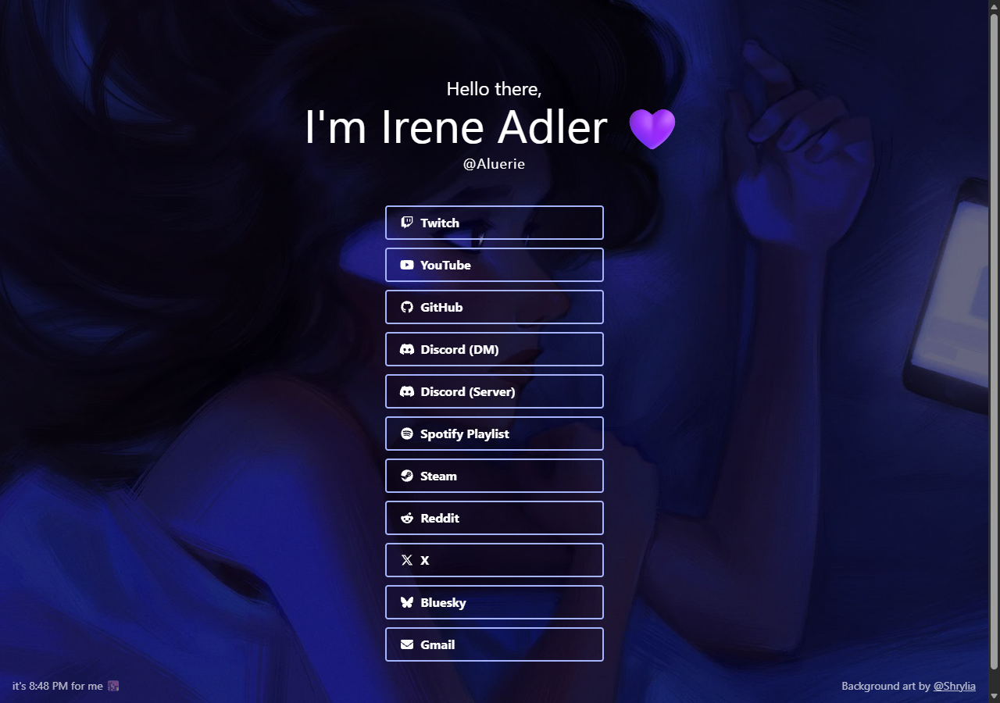

# 💜 aluerie.github.io

My links page, live at <https://aluerie.github.io/>.



It's a single static page (`index.html`, with styles in `css/`, scripts in `js/` and images in `img/`) served by GitHub Pages straight from `main`, with no build step.

## ✨ Features

- A random greeting for the visitor's time of day.
- Floating hearts on click, hold and mouse move (off when the system asks for reduced motion).
- Click `@Aluerie` to copy the handle.
- "it's 1:52 AM for me 🌙" in the bottom-left corner, in UTC.
- The Twitch button glows and gets a LIVE badge while I'm streaming.
- Hovering a link button shows a notification with live info (`js/status.js`): Twitch stream status via [DecAPI](https://decapi.me/), Discord server size via Discord's invite API, GitHub stats and latest activity, and Discord presence, Spotify and current game via [Lanyard](https://github.com/Phineas/lanyard). Each one falls back to plain text if its service doesn't answer.
- A custom Discord card when the link is posted in Discord.
- A handful of easter eggs (in `js/eggs.js` and `js/hearts.js`), and a catch-the-hearts mini-game on the 404 page (`js/catch.js`).

## 🔗 Adding or changing a link

Every link is written out twice in `index.html`, so change both:

1. The button list in `<main>`. A new button needs a `brand-*` class in `css/style.css` and, for a new logo, an icon `<symbol>` in the SVG sprite at the top of `<body>`.
2. The Discord card JSON in `<head>`. Discord allows at most 5 buttons per row and only web links, so `mailto:` stays page-only.

A GitHub Action ([check_discord_card.py](.github/scripts/check_discord_card.py)) fails if the two lists don't match. Run it locally with:

```sh
python .github/scripts/check_discord_card.py
```

Another Action ([dead-links.yml](.github/workflows/dead-links.yml)) checks every link once a week, Discord invites included, and opens an issue if any are broken.

## 📊 GitHub stats

The GitHub hover notification shows commits this month and lines written per language this week. The public API doesn't give those, so [github-stats.yml](.github/workflows/github-stats.yml) runs [github_stats.py](.github/scripts/github_stats.py) every 6 hours and force-pushes the result as `github.json` to the `stats` branch, which the page reads from raw.githubusercontent.com.

To test the Discord card after pushing, wait about 10 minutes, then post `https://aluerie.github.io/?v=<new number>` so Discord fetches it fresh.

## 📜 License

The code is under the [MIT License](LICENSE). The background art is by [@Shrylia](https://x.com/shrylia) and isn't covered by it. The icons are [Font Awesome Free](https://fontawesome.com/license/free) (CC BY 4.0).
